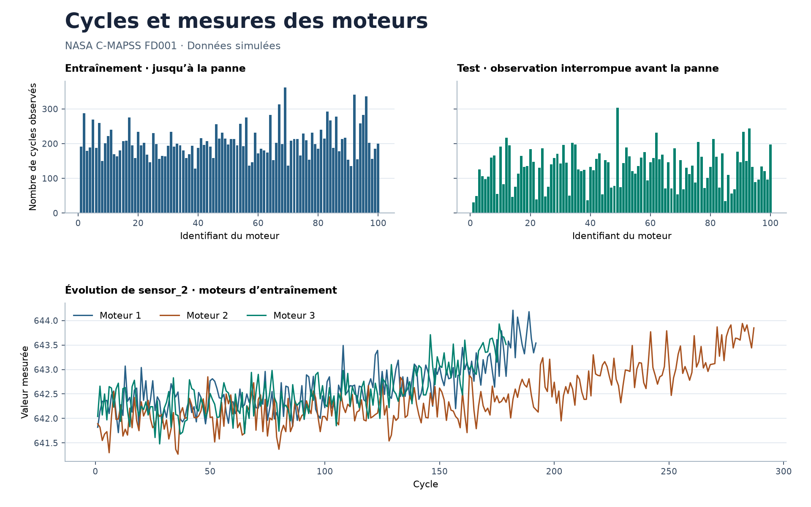
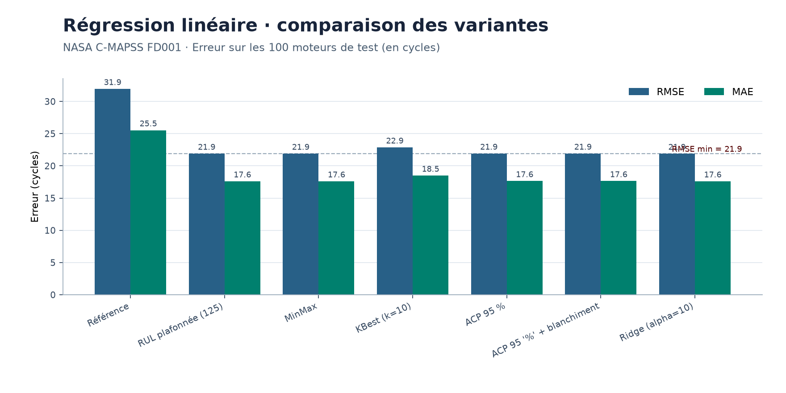
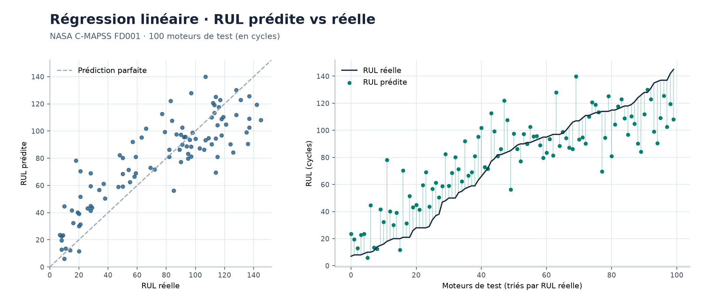

# cmapss-rul-prediction
Prédiction de la durée de vie restante de moteurs d’avion sur NASA C-MAPSS : comparaison entre régression linéaire, SVR et perceptron multicouche.


## Installation

Depuis la racine du projet, crée et active un environnement Python,
puis installe les dépendances listées dans [requirements.txt](requirements.txt).

```bash
python -m venv .venv
source .venv/bin/activate
python -m pip install -r requirements.txt
```

## main.py







## Regression lineaire

1. load data
2. pretraitement -> standardiser (retirer capteurs constant)
3. Regression lineaire
    3.1 Reference
    3.2 Plafonne a 125
    3.3 MinMax
    3.4 KBest
    3.5 ACP 95%
    3.6 ACP 95% + Blanchissement
    3.7 Ridge
4. Régression à vecteurs de soutien (SVR) avec noyau
    4.1 SVR a noyau RBF
        4.1.1 Reference
        4.1.2 ACP 95%
        4.1.3 ACP 95% + blanchissement
    4.2 SVR a noyau linéaire
        4.2.1 Reference
        4.2.2 ACP 95%
        4.2.3 ACP 95% + blanchissement
    4.3 SVR a noyau polynomial
        4.3.1 Reference
        4.3.2 ACP 95%
        4.3.3 ACP 95% + blanchissement
    4.4 SVR a noyau sigmoide
        4.4.1 Reference
        4.4.2 ACP 95%
        4.4.3 ACP 95% blanchissement